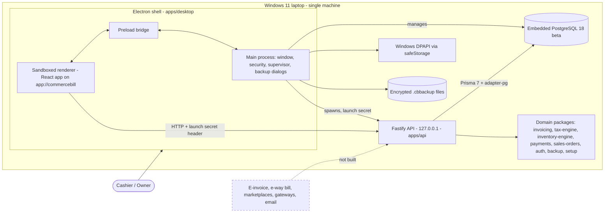
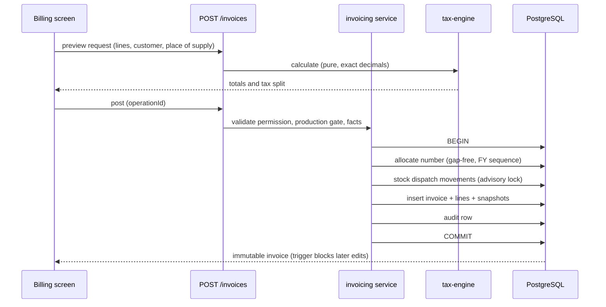
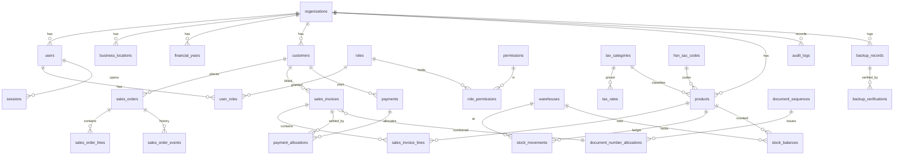
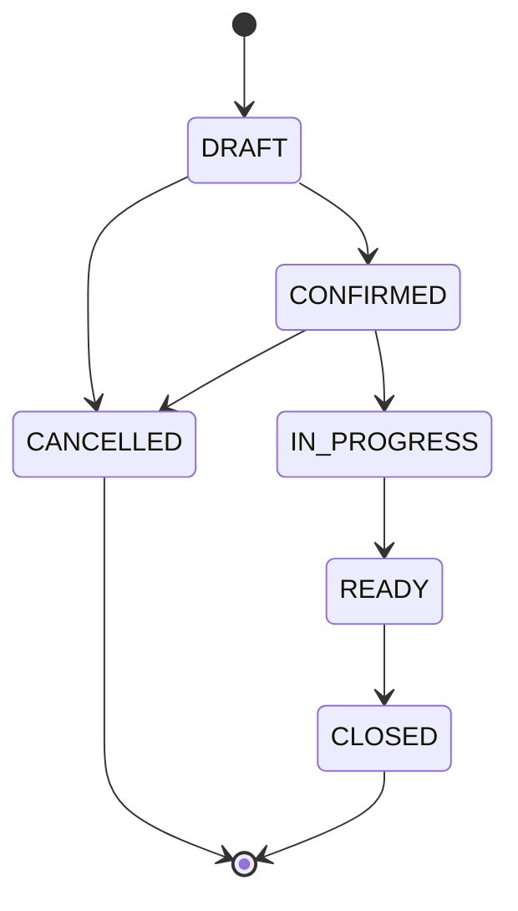
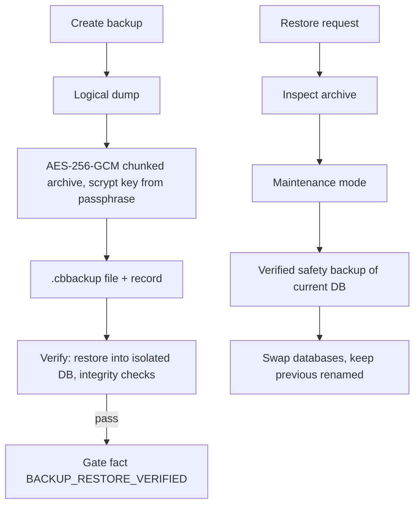
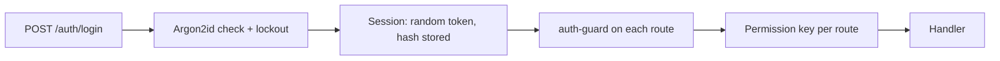

# 12. Architecture and Data Diagrams

All diagrams are Mermaid. They show what **exists today**; planned items are marked dashed.

## 1. System context and runtime

## 2. Invoice posting sequence

## 3. Core entity-relationship diagram

## 4. Sales order status machine (DB-enforced)

The exact transitions are enforced by a database trigger and mirrored in `packages/sales-orders`; consult that package for the authoritative list (the diagram is a summary).

## 5. Backup and restore flow

## 6. Authentication and authorization

## 7. Planned (not built) integration architecture

E-invoice/IRN, e-way bill, marketplace import and payment gateway would attach at the API boundary through `integration-core` (README only today). Card data must never enter the system; use hosted checkout and signed idempotent webhooks.
